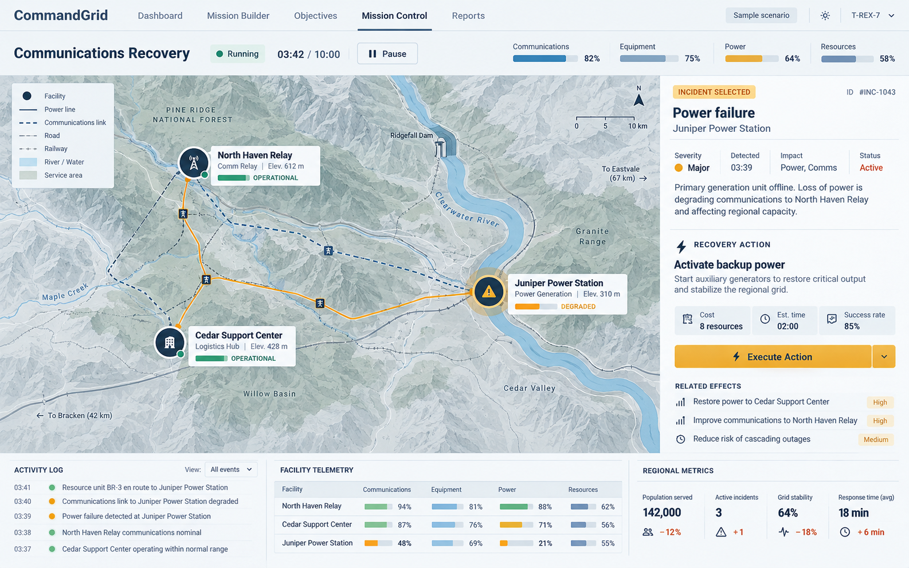
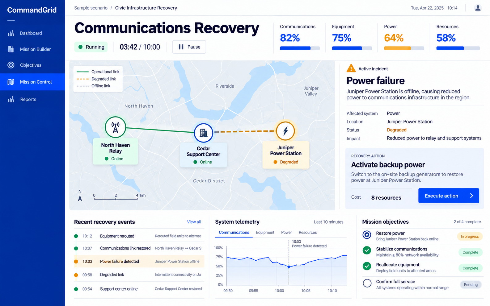
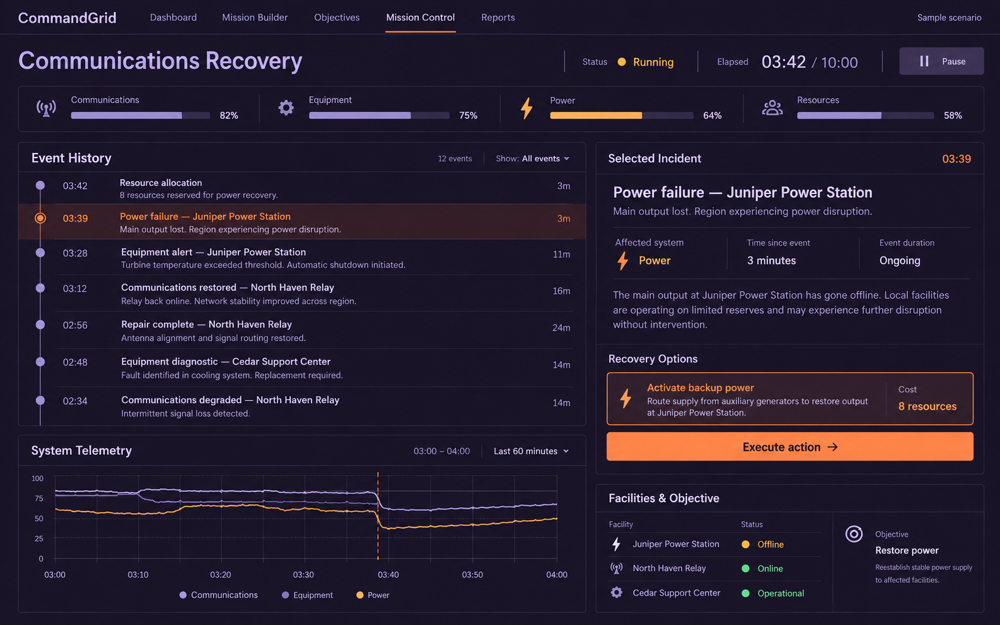

# Mission Control mockups

## A — Spatial atlas

Map-led composition with terrain context and a side incident inspector.

## B — Civic systems

Bright cobalt workspace, larger status numbers and clear navigation.

## C — Recovery sequence

Dark timeline workspace with events and telemetry alongside recovery actions.

Static design explorations only. All scenario content is illustrative; generated dates, derived durations and annotations are placeholders requiring correction before implementation. No direction is approved.
